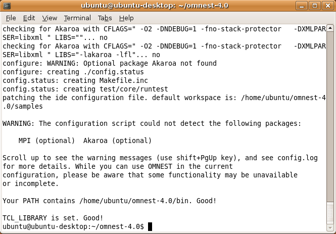
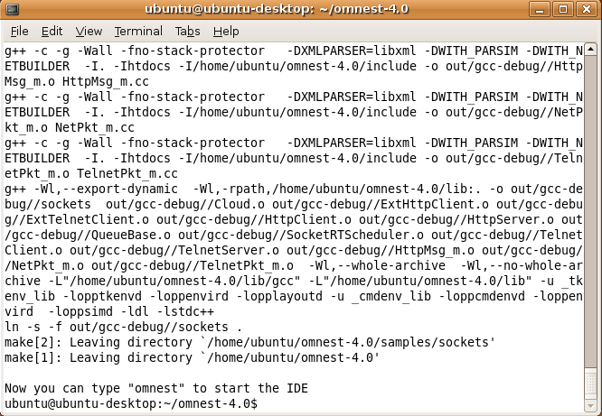
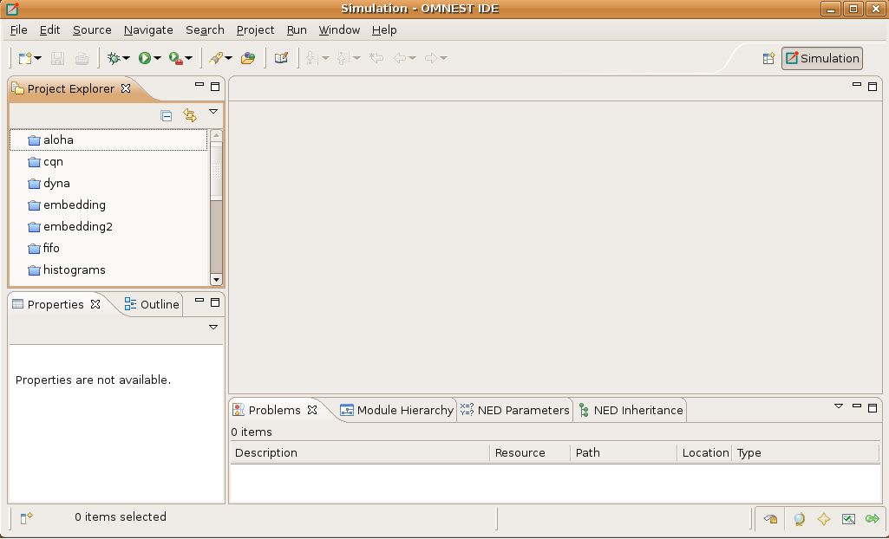

Linux
=====

Supported Linux Distributions
-----------------------------

This guide provides installation instructions for |omnet++| on various Linux distributions. The ``install.sh`` script, included with |omnet++|, automates much of this process.

The following distributions and versions are explicitly covered by the ``install.sh`` script and have dedicated chapters or sections in this guide:

-  **Ubuntu**: 24.04 LTS, 26.04 LTS, 26.10 (and derivatives like Linux Mint)
-  **Debian**: 13 (follow the Ubuntu chapter)
-  **Fedora**: 45 (and similar RPM-based distributions)
-  **Red Hat Enterprise Linux (RHEL), AlmaLinux**: 9.x and 10.x (and compatible distributions like RockyLinux, CentOS Stream)
-  **OpenSUSE**: Leap 16.0, Tumbleweed (rolling release)
-  **Arch Linux**: (rolling release)
-  **NixOS**: (25.11 or later)

This chapter describes the general installation process common to these distributions. For distribution-specific details, particularly regarding the installation of prerequisite system packages, please refer to the relevant chapter:

-  :ref:`ch-ubuntu`
-  :ref:`ch-fedora`
-  :ref:`ch-redhat`
-  :ref:`ch-opensuse`
-  :ref:`ch-archlinux`
-  :ref:`ch-nixos`

If you are using the ``install.sh`` script, it will attempt to auto-detect your distribution and install the necessary system packages.

.. note::

   If your Linux distribution is not listed above, you still may be able to use some distro-specific instructions in
   this Guide.

   Ubuntu derivatives (Ubuntu instructions may apply):

   -  Kubuntu, Xubuntu, Edubuntu, …
   -  Linux Mint

   Some Debian-based distros (Ubuntu instructions may apply, as Ubuntu itself is based on Debian):

   -  Knoppix and derivatives
   -  Mepis

   Some Fedora-based distros (Fedora instructions may apply):

   -  Simplis
   -  Eeedora

Installing the Prerequisite Packages
------------------------------------

|omnet++| requires several packages to be installed on the computer. These packages include the C++ compiler (gcc or
clang) and several other libraries and programs. These packages can be installed from the software
repositories of your Linux distribution.

**See the chapter specific to your Linux distribution for instructions on installing the packages needed by |omnet++|.**

Generally, you will need superuser permissions to install packages.

Not all packages are available from software repositories; some (optional) ones need to be downloaded separately from
their web sites, and installed manually. See the section *Additional Packages* later in this chapter.

Downloading and Unpacking
-------------------------

Download |omnet++| from |downloadsite|. Make sure you select to download
the Linux specific archive, ``|omnetpp|-|version|-linux-x86_64.tgz``.

Copy the archive to the directory where you want to install it. This is usually your home directory, ``/home/<you>``.
Open a terminal, and extract the archive using the following command:

.. code::

   $ tar xvfz |omnetpp|-|version|-linux-x86_64.tgz

This will create an ``|omnetpp|-|version|`` subdirectory with the |omnet++| files in it.

.. note::

   On how to open a terminal on your Linux installation, see the chapter specific to your Linux distribution.

Setting up the Python Virtual Environment
-----------------------------------------

|omnet++| uses Python for various tools and scripts. It is highly recommended to use a Python virtual environment to manage dependencies and avoid conflicts with system-wide Python packages.

The ``install.sh`` script automates the creation and setup of this virtual environment for most Linux distributions.

If you are installing manually or want to understand the process, the typical steps performed by the script (after system packages, including ``python3`` and ``uv``, are installed) are:

1.  Navigate to the |omnet++| root directory (e.g., ``cd |omnetpp|-|version|``).
2.  Create the virtual environment (this example uses ``.venv`` as the directory name):

    .. code:: bash

       $ uv venv --python python3 --seed --prompt "omnetpp/.venv" .venv

3.  Activate the virtual environment:

    .. code:: bash

       $ source .venv/bin/activate

4.  Install required Python packages using ``uv``:

    .. code:: bash

       $ uv pip install -r python/requirements.txt

If ``uv`` is not available on your system, ``install.sh`` installs it for the current user with ``pipx``
or ``pip install --user``. You can also do without it: create the virtual environment with
``python3 -m venv .venv --upgrade-deps --clear --prompt "omnetpp/.venv"`` and install the packages with
``python3 -m pip install -r python/requirements.txt``.

Once the virtual environment is active, your shell prompt will usually change, and calls to ``python`` and ``pip`` will use the versions within the ``.venv`` directory.

.. note::
   If you use the ``install.sh`` script, these steps are generally handled for you.

Environment Variables
---------------------

In general |omnet++| requires that certain environment variables are set and the
`|omnetpp|-|version|/bin` directory is in the PATH. Source the `setenv` 
script to set up all these variables. 

.. code::

  $ cd |omnetpp|-|version|
  $ source setenv

To set the environment variables permanently, edit ``.profile`` or ``.zprofile`` in your home directory and
add a line something like this:
  
.. code::
  
     [ -f "$HOME/|omnetpp|-|version|/setenv" ] && source "$HOME/|omnetpp|-|version|/setenv"

.. note::

   The `setenv` script requires Bash or Zsh.

Configuring and Building |omnet++|
----------------------------------

In the top-level |omnet++| directory, type:

.. code::

   $ ./configure

The ``configure`` script detects installed software and configuration of your system. It writes the results into the
``Makefile.inc`` file, which will be read by the makefiles during the build process.

   Configuring |omnet++|

.. note::

   If there is an error during ``configure``, the output may give hints about what went wrong. Scroll up to see the
   messages. (Use Shift+PgUp; you may need to increase the scrollback buffer size of the terminal and re-run
   ``./configure``.) The script also writes a very detailed log of its operation into ``config.log`` to help track down
   errors. Since ``config.log`` is very long, it is recommended that you open it in an editor and search for phrases
   like *error* or the name of the package associated with the problem.

When ``./configure`` has finished, you can compile |omnet++|. Type in the terminal:

.. code::

   $ make

   Building |omnet++|

.. tip::

   To take advantage of multiple processor cores, add the ``-j8`` option to the ``make`` command line.

.. note::

   The build process will not write anything outside its directory, so no special privileges are needed.

.. tip::

   The make command will seemingly compile everything twice. This is because both debug and optimized versions of the
   libraries are built. If you only want to build one set of the libraries, specify ``MODE=debug`` or ``MODE=release``:

Verifying the Installation
--------------------------

You can now verify that the sample simulations run correctly. For example, the aloha simulation is started by entering
the following commands:

.. code::

   $ cd samples/aloha
   $ ./aloha

By default, the samples will run using the Qtenv environment. You should see nice gui windows and dialogs.

Starting the IDE
----------------

You can launch the |omnet++| Simulation IDE by typing the following command in the terminal:

.. code::

   $ |omnetpp|

   The Simulation IDE

If you would like to be able to access the IDE from the application launcher or via a desktop shortcut, run one or both
of the commands below:

.. code::

   $ make install-menu-item
   $ make install-desktop-icon

Or add a shortcut that points to the ``|omnetpp|`` program in the ``ide`` subdirectory by other means, for example using
the Linux desktop’s context menu.

Using the IDE
-------------

When you try to build a project in the IDE, you may get the following warning message:

   Toolchain "…" is not supported on this platform or installation. Please go to the Project menu, and activate a
   different build configuration. (You may need to switch to the C/C++ perspective first, so that the required menu
   items appear in the Project menu.)

If you encounter this message, choose *Project > Properties > C/C++ Build > Tool Chain Editor > Current toolchain >
GCC for |omnet++|*.

The IDE is documented in detail in the *User Guide*.

Reconfiguring the Libraries
---------------------------

If you need to recompile the |omnet++| components with different flags (e.g. different optimization), then change the
top-level |omnet++| directory, edit ``configure.user`` accordingly, then type:

.. code::

   $ ./configure
   $ make cleanall
   $ make

If you want to recompile just a single library, then change to the directory of the library (e.g. ``cd src/sim``) and
type:

.. code::

   $ make clean
   $ make

By default, libraries are compiled in both debug and release mode. If you want to make release or debug builds only,
use:

.. code::

   $ make MODE=release

or

.. code::

   $ make MODE=debug

By default, shared libraries will be created. If you want to build static libraries, set ``SHARED_LIBS=no`` in
``configure.user`` and re-configure your project.

.. note::

   For detailed description of all options please read the *Build Options* chapter.

Additional Packages
-------------------

Note that at this point, MPI, Doxygen and GraphViz have been installed as part of the prerequisites.

Qtenv
~~~~~

|omnet++| comes with a Qt based runtime environment that supports also 3D visualization. The new environment can be
disabled by the WITH_QTENV=no variable in the configure.user file and then running ``./configure``.

Akaroa
~~~~~~

Linux distributions do not contain the Akaroa package. It must be downloaded, compiled and installed manually before
installing |omnet++|.

.. note::

   As of version 2.7.9, Akaroa only supports Linux and Solaris.

Download Akaroa 2.7.9 from: http://www.cosc.canterbury.ac.nz/research/RG/net_sim/simulation_group/akaroa/download.chtml

Extract it into a temporary directory:

.. code::

   $ tar xfz akaroa-2.7.9.tar.gz

Configure, build and install the Akaroa library. By default, it will be installed into the ``/usr/local/akaroa``
directory.

.. code::

   $ ./configure
   $ make
   $ sudo make install

Go to the |omnet++| directory, and (re-)run the ``configure`` script. Akaroa will be automatically detected if you
installed it to the default location.

.. ifconfig:: what=='omnest'

   SystemC
   ~~~~~~~

   To enable SystemC integration, add SYSTEMC=yes to the configure.user file, run *configure* and then rebuild your
   project. You can check the systemc examples in the samples/systemc-embedding directory.

Nemiver
~~~~~~~

Nemiver is the default debugger for the |omnet++| just-in-time debugging facility (see the
``debugger-attach-on-startup`` and ``debugger-attach-on-error`` configuration options). Nemiver can be installed via the
package manager in most Linux distros. For example, on Ubuntu and other Debian-based distros you can install it by the
following command:

.. code::

   $ sudo apt-get install nemiver
