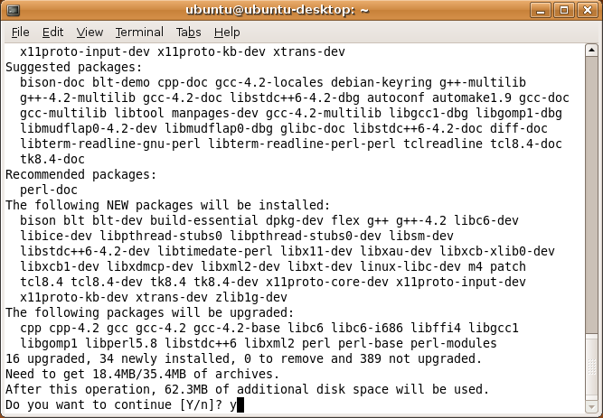

Ubuntu
======

Supported Releases
------------------

This chapter provides additional information for installing |omnet++| on Ubuntu and Debian installations. The overall
installation procedure is described in the *Linux* chapter.

The following Ubuntu and Debian releases are known to work (based on the ``install.sh`` script):

-  Ubuntu 24.04 LTS
-  Ubuntu 26.04 LTS
-  Ubuntu 26.10 (and likely newer versions)
-  Debian 13

The instructions below assume that you use the default desktop and the bash shell. If you use another desktop
environment or shell, you may need to adjust the instructions accordingly.

Installing the Prerequisite Packages
------------------------------------

Before starting the installation, it's a good practice to refresh the database of available
packages. Type in the terminal:

.. code::

   $ sudo apt update

To install the required packages, ensure you are in the root directory of your |omnet++| download.
The following commands will install the necessary dependencies.

First, install the core development tools and libraries:

.. code::

   $ sudo apt install -y make diffutils pkg-config ccache clang lld gdb lldb \
       bison flex perl sed gawk python3 python3-pip python3-venv python3-dev \
       libxml2-dev zlib1g-dev doxygen graphviz xdg-utils libdw-dev

Next, install packages for the graphical environment (Qtenv and IDE). If you do not need
GUI support (e.g., for a server installation), you can skip this step and later configure
|omnet++| with ``WITH_QTENV=no`` and ``WITH_OSG=no``.

.. code::

   $ sudo apt install -y qt6-base-dev qt6-base-dev-tools qmake6 libqt6svg6 \
       qt6-wayland libwebkit2gtk-4.1-0

For 3D visualization support in Qtenv, install the OpenSceneGraph development package. If you
do not need 3D support, you can skip this step and later configure |omnet++| with ``WITH_OSG=no``.

.. code::

   $ sudo apt install -y libopenscenegraph-dev

After installing system packages, it's good practice to clean the local repository of retrieved package files:

.. code::

   $ sudo apt clean

Install ``uv``, which is used to set up the Python environment. It is not packaged for Ubuntu, so install it with ``pipx``
(``uv`` will be placed in ``~/.local/bin``; ``pipx ensurepath`` adds it to your ``PATH`` in new terminals):

.. code::

   $ sudo apt install -y pipx
   $ pipx install uv
   $ pipx ensurepath

Next, set up a Python virtual environment for |omnet++| using ``uv``. In the root directory of your |omnet++| download:

.. code::

   $ UV_PYTHON_DOWNLOADS=never uv venv --python python3 --seed --prompt "omnetpp/.venv" .venv
   $ source .venv/bin/activate

Then, install the required Python packages into the virtual environment:

.. code::

   $ uv pip install -r python/requirements.txt

.. note::

   If you prefer not to use ``uv``, create the virtual environment with
   ``python3 -m venv .venv --upgrade-deps --clear --prompt "omnetpp/.venv"`` and install the packages with
   ``python3 -m pip install -r python/requirements.txt`` instead.

.. note::

   The commands above install Clang as the C++ compiler and LLD as the linker. If you prefer to use GCC and the system's default linker, you can adjust the package list accordingly (e.g., replace ``clang`` with ``g++`` and omit ``lld``) and set the ``PREFER_CLANG=no`` and ``PREFER_LLD=no`` options in the ``configure.user`` file or during the ``./configure`` step.
   If you skip the GUI or 3D packages, remember to disable the corresponding features (``WITH_QTENV=no``, ``WITH_OSG=no``) in ``configure.user`` or during the ``./configure`` step.

To enable the optional parallel simulation support you will need to install the MPI packages:

.. code::

   $ sudo apt-get install mpi-default-dev

At the confirmation questions (*Do you want to continue? [Y/N]*), answer *Y*.

   Command-Line Package Installation

Post-Installation Steps
~~~~~~~~~~~~~~~~~~~~~~~

Setting Up Debugging
^^^^^^^^^^^^^^^^^^^^

By default, Ubuntu does not allow ptracing of non-child processes by non-root users. That is, if you want to be able to
debug simulation processes by attaching to them with a debugger, or similar, you want to be able to use |omnet++|
just-in-time debugging (``debugger-attach-on-startup`` and ``debugger-attach-on-error`` configuration options), you need
to explicitly enable them.

To temporarily allow ptracing non-child processes, enter the following command:

.. code::

   $ echo 0 | sudo tee /proc/sys/kernel/yama/ptrace_scope

To permanently allow it, edit ``/etc/sysctl.d/10-ptrace.conf`` and change the line:

.. code::

   kernel.yama.ptrace_scope = 1

to read

.. code::

   kernel.yama.ptrace_scope = 0
