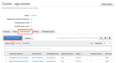
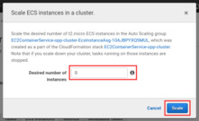
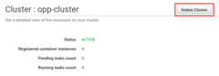
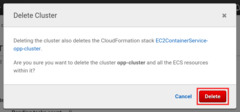

Trying It Out
=============

Configuration
-------------

To try it out, we add a new Configuration to the ``routing`` sample that comes
with |omnet++|.

Append this section to the ``omnetpp.ini`` file in the ``samples/routing`` directory:

.. code-block:: ini

    [Config MeshExperiment]
    network = networks.Mesh
    **.width = ${10..20 step 2}
    **.height = ${10..20 step 2}

    **.destAddresses = "0 2 5 6 9 14 17 18 23 27 29 36 42 52 89 123 150 183 192"
    **.sendIaTime = uniform(100us, 10ms)  # high traffic

    **.vector-recording = false
    sim-time-limit = 10s

This configuration tries to make each of its runs execute for a significant
amount of time - about a minute each on average - by setting up a large network
with a small packet inter-arrival time and a relatively long simulation time
limit. It also disables vector recording to keep the size of the result files
within the limits of the presented solution.

Execution
---------

To run it, open a terminal, set up the necessary environment variables using
``setenv``, then change into the directory of the sample:

.. code-block:: bash

    $ cd /path/to/omnetpp/
    $ . setenv
    $ cd samples/routing

Then execute the ``client.py`` script, substituting the IP address of your Redis
server on AWS:

.. code-block:: bash

    $ python3 /path/to/client.py ./routing -c MeshExperiment --redis-host 172.17.1.19

You should see all runs submitted to the job queue, and after a while, finishing
them. The results should appear in the ``results`` directory, just like with local
execution.

Comparison
----------

You can compare the performance of the cloud solution with that of your own
machine by running the same campaign on both, through the ``time`` utility:

.. code-block:: bash

    $ time python3 /path/to/client.py ./routing -c MeshExperiment --redis-host 172.17.1.19
        …
    $ time opp_runall ./routing -c MeshExperiment

After the output of each command, ``time`` will print a summary of the execution
times.

Locally on my computer, using all ``8`` of its cores, the times were:

.. code-block:: bash

    real	4m37.610s
    user	25m4.576s
    sys	0m0.870s

The most interesting from our perspective is the ``real`` time, as this shows the
amount of wall-clock time it took to run each command. The ``user`` time is the
net processing time. It is much more than the ``real`` time, because it is
aggregated across all cores.

And of the one running on AWS:

.. code-block:: bash

    real	4m12.310s
    user	0m1.931s
    sys	0m1.925s

With just ``3`` single-core workers, the simulation completes faster than running
on ``8`` local cores. The ``user`` time is next to negligible in this case, because
my computer spent most of the time idling, waiting for the results to come back.

Shutting Down
-------------

To prevent the aimless and useless exhaustion of your Free Tier resource
allowance (or in the long term, your credit card balance), it is important to
terminate your allocated resources once you are done using them. In our case,
these are the EC2 Instances started by the ECS Cluster. We need to shut these
down, because when calculating their usage, the whole amount of time the
instances are running (or paused, but kept available) is taken into account,
not just the time when they were actually used, doing something useful.

If you wish to use the Cluster again later, the easiest thing to do is scaling
down the number of underlying EC2 Instances to ``0``. This will of course cause
all running tasks to stop, as they no longer have anything to run on.

   
   Scale Instances

   
   Scale to Zero

Alternatively, you can delete the whole Cluster. This will also terminate the
EC2 Instances, but it will delete the ``worker`` Service as well.

   
   Delete Cluster

   
   Really Delete

The Task Definitions are not deleted either way, but this is not a problem,
since they can be kept around indefinitely, free of charge.
