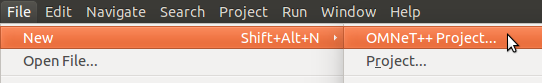
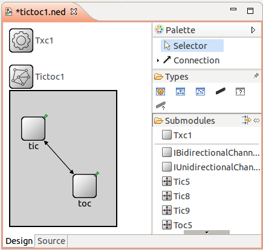
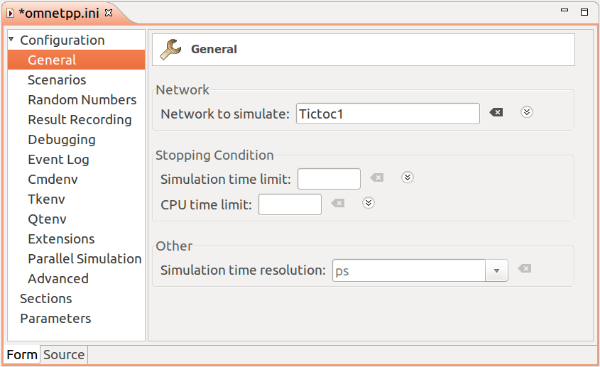

1 - Getting Started
===================

1.1 The model
-------------

For a start, let us begin with a "network" that consists of two nodes.
The nodes will do something simple: one of the nodes will create a packet,
and the two nodes will keep passing the same packet back and forth.
We'll call the nodes `tic` and `toc`. Later we'll gradually
improve this model, introducing |omnet++| features at each step.

Here are the steps you take to implement your first simulation from scratch.

1.2 Setting up the project
--------------------------

Start the |omnet++| IDE by typing :command:`omnetpp` in your terminal. (We assume
that you already have a working |omnet++| installation. If not, please install the latest
version, consulting the :ref:`install-guide` as needed.)
Once in the IDE, choose :menuselection:`New -> |omnet++| Project` from the menu.

A wizard dialog will appear. Enter ``tictoc`` as project name,
choose :guilabel:`Empty project` when asked about the initial content of the project,
then click :guilabel:`Finish`. An empty project will be created, as you can see
in the :guilabel:`Project Explorer`.

.. note:: 
    Some |omnet++| versions will generate a :file:`package.ned` file into the project.
    We don't need it now: delete the file by selecting it and hitting :guilabel:`Delete`.

The project will hold all files that belong to our simulation. In our example,
the project consists of a single directory. For larger simulations, the project's
contents are usually sorted into :file:`src/` and :file:`simulations/` folders,
and possibly subfolders underneath them.

.. note::
    Using the IDE is entirely optional. Almost all functionality of |omnet++|
    (except for some very graphics-intensive and interactive features
    like sequence chart browsing and result plotting) is available on
    the command line. Model source files can be edited with any text editor,
    and |omnet++| provides command-line tools for special tasks such as makefile
    creation, message file to C++ translation, result file querying and data export,
    and so on. To proceed without the IDE, simply create a directory and create the
    following NED, C++ and ini files in it with your favorite text editor.

1.3 Adding the NED file
-----------------------

|omnet++| uses NED files to define components and to assemble them into larger units
like networks. We start implementing our model by adding a NED file.
To add the file to the project, right-click the project directory in the
:guilabel:`Project Explorer` panel on the left, and choose
:menuselection:`New -> Network Description File (NED)`
from the menu. Enter :file:`tictoc1.ned` when prompted for the file name.

Once created, the file can be edited in the :guilabel:`Editor area` of the |omnet++| IDE.
The |omnet++| IDE's NED editor has two modes, :guilabel:`Design` and :guilabel:`Source`; one can switch
between them using the tabs at the bottom of the editor. In :guilabel:`Design` mode,
the topology can be edited graphically, using the mouse and the palette on the right.
In :guilabel:`Source` mode, the NED source code can be directly edited as text.
Changes done in one mode will be immediately reflected in the other, so you can
freely switch between modes during editing, and do each change in whichever mode
it is more convenient. (Since NED files are plain text files, you can even use
an external text editor to edit them, although you'll miss syntax highlighting,
content assist, cross-references and other IDE features.)

Switch into :guilabel:`Source` mode, and enter the following:

.. literalinclude:: code/tictoc1.ned
    :language: ned
    :start-at: simple Txc1 

When you're done, switch back to :guilabel:`Design` mode. You should see something like this:

The first block in the file declares :ned:`Txc1` as a simple module type.
Simple modules are atomic on NED level. They are also active components,
and their behavior is implemented in C++. The declaration also says that
:ned:`Txc1` has an input gate named :gate:`in`, and an output gate named :gate:`out`.

The second block declares :ned:`Tictoc1` as a network. :ned:`Tictoc1` is assembled from two
submodules, ``tic`` and ``toc``, both instances of the module type :ned:`Txc1`.
``tic``'s output gate is connected to ``toc``'s input gate, and vice versa.
There will be a 100ms propagation delay both ways.

.. note::
    You can find a detailed description of the :ref:`cha:ned-lang` in the
    Simulation Manual.
    (The manual can also be found in the :file:`doc`  directory of your |omnet++| installation.)

1.4 Adding the C++ files
------------------------

We now need to implement the functionality of the Txc1 simple module in C++.
Create a file named :file:`txc1.cc` by choosing :menuselection:`New -> Source File` from the
project's context menu (or :menuselection:`File -> New -> File` from the IDE's main menu),
and enter the following content:

.. literalinclude:: code/txc1.cc
    :language: cpp
    :start-at: include

The :ned:`Txc1` simple module type is represented by the C++ class :ned:`Txc1`. The :ned:`Txc1`
class needs to subclass from |omnet++|'s :cpp:`cSimpleModule` class, and needs to be
registered in |omnet++| with the :cpp:`Define_Module()` macro.

.. note::
    It is a common mistake to forget the :cpp:`Define_Module()` line. If it is missing,
    you'll get an error message similar to this one: ``"Error: Class 'Txc1' not found -- perhaps
    its code was not linked in, or the class wasn't registered with Register_Class(), or in
    the case of modules and channels, with Define_Module()/Define_Channel()"``.

We redefine two methods from :cpp:`cSimpleModule`: :cpp:`initialize()` and :cpp:`handleMessage()`.
They are invoked from the simulation kernel: the first one only once, and
the second one whenever a message arrives at the module.

In :cpp:`initialize()` we create a message object (:cpp:`cMessage`), and send it out
on gate :gate:`out`. Since this gate is connected to the other module's
input gate, the simulation kernel will deliver this message to the other module
in the argument to :cpp:`handleMessage()` -- after a 100ms propagation delay
assigned to the link in the NED file. The other module just sends it back
(another 100ms delay), so it will result in a continuous ping-pong.

Messages (packets, frames, jobs, etc) and events (timers, timeouts) are
all represented by :cpp:`cMessage` objects (or its subclasses) in |omnet++|.
After you send or schedule them, they will be held by the simulation
kernel in the "scheduled events" or "future events" list until
their time comes and they are delivered to the modules via :cpp:`handleMessage()`.

Note that there is no stopping condition built into this simulation:
it would continue forever. You will be able to stop it from the GUI.
(You could also specify a simulation time limit or CPU time limit
in the configuration file, but we don't do that in the tutorial.)

1.5  Adding omnetpp.ini
-----------------------

To be able to run the simulation, we need to create an :file:`omnetpp.ini` file.
:file:`omnetpp.ini` tells the simulation program which network you want to simulate
(as NED files may contain several networks), you can pass parameters
to the model, explicitly specify seeds for the random number generators, etc.

Create an :file:`omnetpp.ini` file using the :menuselection:`File -> New -> Initialization file (INI)`
menu item. The new file will open in an :guilabel:`Inifile Editor`.
As the NED Editor, the Inifile Editor also has two modes, ::guilabel:`Form` and :guilabel:`Source`,
which edit the same content. The former is more suitable for configuring the
simulation kernel, and the latter for entering module parameters.

For now, just switch to *Source* mode and enter the following:

.. code-block:: ini

    [General]
    network = Tictoc1

You can verify the result in *Form* mode:

``tictoc2`` and further steps will all share a common :download:`omnetpp.ini <code/omnetpp.ini>` file.

We are now done with creating the first model, and ready to compile and run it.

Sources: :download:`tictoc1.ned <code/tictoc1.ned>`, :download:`txc1.cc <code/txc1.cc>`, :download:`omnetpp.ini <code/omnetpp.ini>`
