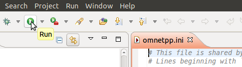
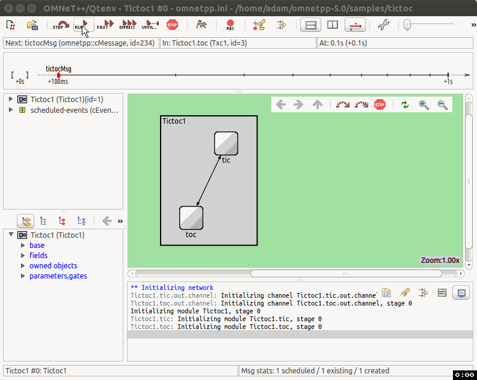
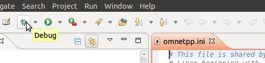
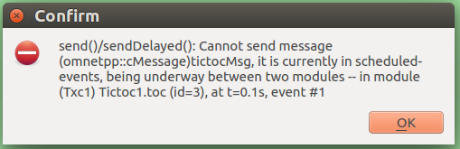
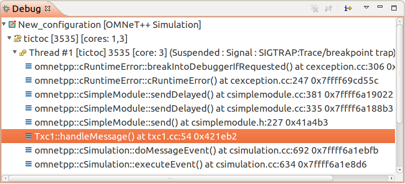
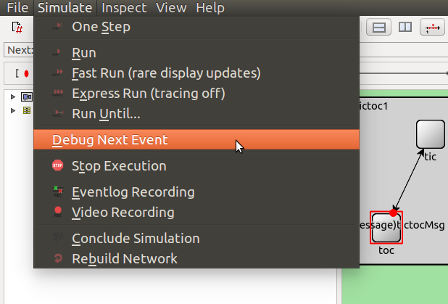
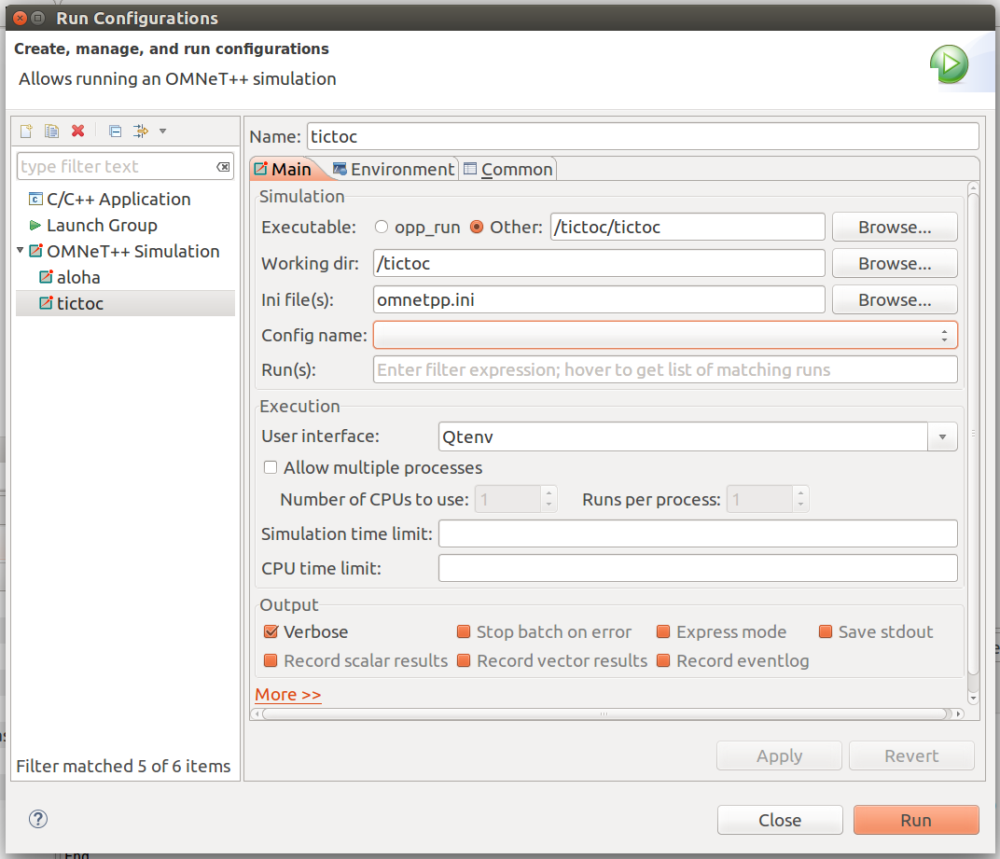
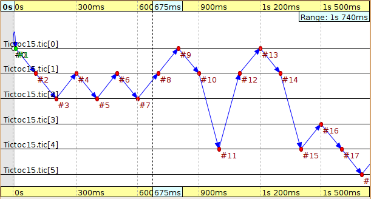

2 - Running the Simulation
==========================

2.1 Launching the simulation program
------------------------------------

Once you complete the previous steps, you can launch the simulation by selecting
``omnetpp.ini`` (in either the editor area or the :guilabel:`Project Explorer`),
and pressing the :guilabel:`Run` button.

The IDE will build your project automatically. If there are compilation errors,
you need to rectify those until you get an error-free compilation and linking.
You can manually trigger a build by hitting choosing :menuselection:`Project -> Build All`
from the menu, or hitting :kbd:`Ctrl+B`.

.. note::
    If you want to build the simulation executable on the command-line,
    create a :file:`Makefile` using the :command:`opp_makemake`
    command, then enter :command:`make` to build the project. It will produce
    an executable that can be run by entering ``./tictoc``.

2.2 Running the simulation
--------------------------

After successfully building and launching your simulation, you should see
a new GUI window appear, similar to the one in the screenshot below.
The window belongs to :guilabel:`Qtenv`, the main |omnet++| simulation runtime GUI.
You should also see the network containing ``tic`` and ``toc`` displayed
graphically in the main area.

Press the :guilabel:`Run` button on the toolbar to start the simulation. What you should
see is that ``tic`` and ``toc`` are exchanging messages with each other.

The main window toolbar displays the current simulation time. This is virtual time,
it has nothing to do with the actual (or wall-clock) time that the program takes to
execute. Actually, how many seconds you can simulate in one real-world second
depends highly on the speed of your hardware and even more on the nature and
complexity of the simulation model itself.

Note that it takes zero simulation time for a node to process the message.
The only thing that makes the simulation time pass in this model is
the propagation delay on the connections.

You can play with slowing down the animation or making it faster with
the slider at the top of the graphics window. You can stop the simulation
by hitting :kbd:`F8` (equivalent to the STOP button on the toolbar), single-step
through it :kbd:`F4`, run it with :kbd:`F5` or without :kbd:`F6` animation.
:kbd:`F7` (express mode) completely turns off tracing features for maximum speed.
Note the event/sec and simsec/sec gauges on the status bar of the
main window (only visible when the simulation is running in fast or express mode).

.. note:: 
    :title: Exercise

    Explore the GUI by running the simulation several times. Try
    :guilabel:`Run`, :guilabel:`Run Until`, :guilabel:`Rebuild Network`, and other functions.
    You can exit the simulation program by clicking its :guilabel:`Close` icon or
    choosing :menuselection:`File -> Exit`.

2.3 Debugging
-------------

The simulation is just a C++ program, and as such, it often needs to be
debugged while it is being developed. In this section we'll look at the
basics of debugging to help you acquire this vital task.

The simulation can be started in debug mode by clicking the :guilabel:`Debug`
button on the IDE's main toolbar.

This will cause the simulation program to be launched under a debugger
(usually :command:`gdb`). The IDE will also switch into :guilabel:`Debug perspective`,
i.e. rearrange its various panes and views to a layout which is better
suited to debugging. You can end the debugging session with the
:guilabel:`Terminate` button (a red square) on the toolbar.

Runtime errors
~~~~~~~~~~~~~~

Debugging is most often needed to track down runtime errors. Let's try it!
First, deliberately introduce an error into the program. In
:file:`txc1.cc`, duplicate the `send()` line inside
:cpp:`handleMessage()`, so that the code looks like this:

.. code-block:: cpp

    void Txc1::handleMessage(cMessage *msg)
    {
        //...
        send(msg, "out"); // send out the message
        send(msg, "out"); // THIS SHOULD CAUSE AN ERROR
    }

When you launch the simulation in normal mode (:guilabel:`Run` button) and try to run it,
you'll get an error message like this:

Now, run the simulation in :guilabel:`Debug` mode. Due to a ``debug-on-errors`` option
being enabled by default, the simulation program will stop in the debugger.
You can locate the error by examining the stack trace (the list of nested
function calls) in the :guilabel:`Debug` view:

You can see that it was |omnet++|'s :cpp:`breakIntoDebuggerIfRequested()` method that
activated the debugger. From then on, you need to search for a function that
looks familiar, i.e. for one that is part of the model. In our case, that is
the ``Txc1::handleMessage() at txc1.cc:54`` line. Selecting that line will
show you the corresponding source code in the editor area, and lets you
examine the values of variables in the :guilabel:`Variables` view. This information
will help you determine the cause of the error and fix it.

Crashes
~~~~~~~

Tracking down crashes i.e. segfaults is similar, let's try that as well.
Undo the previous source code edit (remove the duplicate :cpp:`send()` line),
and introduce another error. Let's pretend we forgot to create the message
before sending it, and change the following lines in `initialize()`

.. code-block:: cpp

    cMessage *msg = new cMessage("tictocMsg");
    send(msg, "out");

to simply

.. code-block:: cpp

    cMessage *msg; // no initialization!
    send(msg, "out");

When you run the simulation, it will crash. (You will get an error message
similar to ``Simulation terminated with exit code: 139``). If you launch the simulation
again, this time in :guilabel:`Debug` mode, the crash will bring you into the debugger.
Once there, you'll be able to locate the error in the :guilabel:`Debug` view and examine
variables, which will help you identify and fix the bug.

Breakpoints
~~~~~~~~~~~

You can also manually place breakpoints into the code. Breakpoints will stop
execution, and let you examine variables, execute the code line-by-line,
or resume execution (until the next breakpoint).

A breakpoint can be placed at a specific line in the source code by double-clicking
on the left gutter in the editor, or choosing :guilabel:`Toggle Breakpoint` from
the context menu. The list of active (and inactive) breakpoints can be examined
in the :guilabel:`Breakpoints` view.

.. note:: 
    :title: Exercise

    Experiment with breakpoints! Place a breakpoint at the beginning of
    the :cpp:`handleMessage()` method function, and run the simulation. Use appropriate
    buttons on the toolbar to single-step, continue execution until next time the
    breakpoint is hit, and so on.

Debug next event
~~~~~~~~~~~~~~~~

If you did the previous exercise, you must have noticed that the breakpoint
was triggered at each and every event in the Txc1 simple module. In real life
it often occurs that an error only surfaces at, say, the 357th event in that module,
so ideally that's when you'd want to start debugging. It is not very convenient
to have to hit :guilabel:`Resume` 356 times just to get to the place of the error.
A possible solution is to add a *condition* or an *ignore*-count to the
breakpoint (see :guilabel:`Breakpoint Properties` in its context menu). However,
there is a potentially more convenient solution.

In `Qtenv`, use :guilabel:`Run Until` to get to the event to be debugged. Then,
choose :menuselection:`Simulation -> Debug Next Event` from the menu. This will trigger
a breakpoint in the debugger at the beginning of :cpp:`handleMessage()` of the
next event, and you can start debugging that event.

2.4 The Debug/Run dialog
------------------------

Let us return to launching simulations once more.

When you launch the simulation program with the :guilabel:`Run` or :guilabel:`Debug`
buttons on the IDE toolbar, settings associated with the launch
are saved in a `launch configuration`. Launch configurations
can be viewed in the :guilabel:`Run/Debug Configurations` dialog which
can be opened e.g. by clicking the little *down* arrow next to the
:guilabel:`Run` (:guilabel:`Debug`) toolbar button to open a menu, and choosing
:guilabel:`Run (Debug) Configurations...` in it. In the same menu, you can also
click the name of a launch configuration (e.g. *tictoc*) while
holding down the :kbd:`Ctrl` key to open the dialog with the corresponding
configuration.

The dialog allows you activate various settings for the launch.

2.5 Visualizing on a Sequence Chart
-----------------------------------

The |omnet++| simulation kernel can record the message exchanges during the
simulation into an *event log file*. To enable recording the event log,
check the :guilabel:`Record eventlog` checkbox in the launch configuration dialog.
Alternatively, you can specify ``record-eventlog = true`` in ``omnetpp.ini``,
or even, use the :guilabel:`Record` button in the Qtenv graphical runtime environment
after launching.

The log file can be analyzed later with the :guilabel:`Sequence Chart` tool in the IDE.
The :file:`results` directory in the project folder contains the :file:`.elog` file.
Double-clicking on it in the |omnet++| IDE opens the :guilabel:`Sequence Chart` tool,
and the event log tab at the bottom of the window.

.. note::

    The resulting log file can be quite large, so enable this feature only
    if you really need it.

The following figure has been created with the :guilabel:`Sequence Chart` tool, and shows
how the message is routed between the different nodes in the network.
In this instance the chart is very simple, but when you have a complex model,
sequence charts can be very valuable in debugging, exploring or documenting
the model's behavior.

Sources: :download:`tictoc1.ned <code/tictoc1.ned>`, :download:`txc1.cc <code/txc1.cc>`, :download:`omnetpp.ini <code/omnetpp.ini>`

