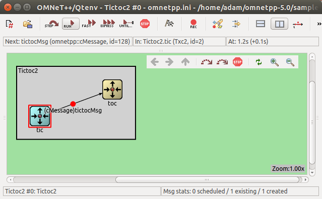
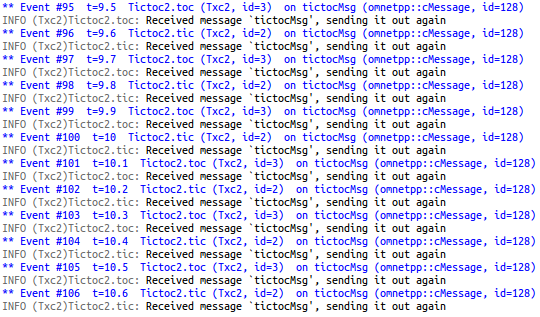
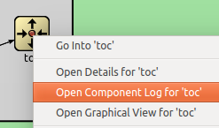
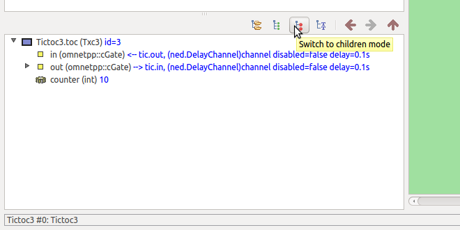
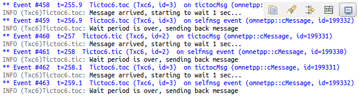
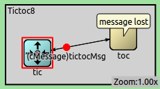

3 - Enhancing the 2-node TicToc
===============================

3.1 Adding icons
----------------

Here we make the model look a bit prettier in the GUI. We assign
the ``block/routing`` icon (the file :file:`images/block/routing.png`),
and paint it cyan for ``tic`` and yellow for ``toc``. This is achieved
by adding display strings to the NED file. The ``i=`` tag in the
display string specifies the icon.

.. literalinclude:: code/tictoc2.ned
    :language: ned
    :start-at: simple Txc2
    :emphasize-lines: 4, 19, 23 

You can see the result here:

3.2 Adding logging
------------------

We also modify the C++ code. We add log statements to :ned:`Txc1` so that it
prints what it is doing. |omnet++| provides a sophisticated logging facility
with log levels, log channels, filtering, etc. that are useful for large
and complex models, but in this model we'll use its simplest form :cpp:`EV`:

.. literalinclude:: code/txc2.cc
    :language: cpp
    :start-at: Sending initial 
    :end-at: Sending initial
    :dedent:

and

.. literalinclude:: code/txc2.cc
    :language: cpp
    :start-after: here it will be 
    :end-at: EV
    :dedent:

When you run the simulation in the |omnet++| runtime environment, the following output
will appear in the log window:

You can also open separate output windows for ``tic`` and ``toc`` by right-clicking
on their icons and choosing :guilabel:`Component log` from the menu. This feature
will be useful when you have a large model ("fast scrolling logs syndrome")
and you're interested only in the log messages of specific module.

Sources: :download:`tictoc2.ned <code/tictoc2.ned>`, :download:`txc2.cc <code/txc2.cc>`, :download:`omnetpp.ini <code/omnetpp.ini>`

3.3 Adding state variables
--------------------------

In this step we add a counter to the module, and delete the message
after ten exchanges.

We add the counter as a class member:

.. literalinclude:: code/txc3.cc
    :language: cpp
    :start-at: class Txc3 
    :end-at: protected

We set the variable to 10 in :cpp:`initialize()` and decrement in :cpp:`handleMessage()`,
that is, on every message arrival. After it reaches zero, the simulation
will run out of events and terminate.

Note the

.. literalinclude:: code/txc3.cc
    :language: cpp
    :start-at: The WATCH() statement
    :end-at: WATCH(counter)
    :dedent:

line in the source: this makes it possible to see the counter value
in the graphical runtime environment.

If you click on ``tic``'s icon, the inspector window in the bottom left corner of the main window will display
details about ``tic``. Make sure that :guilabel:`Children` mode is selected from the toolbar at the top.
The inspector now displays the counter variable.

As you continue running the simulation, you can follow as the counter
keeps decrementing until it reaches zero.

Sources: :download:`tictoc3.ned <code/tictoc3.ned>`, :download:`txc3.cc <code/txc3.cc>`, :download:`omnetpp.ini <code/omnetpp.ini>`

3.4 Adding parameters
---------------------

In this step you'll learn how to add input parameters to the simulation:
we'll turn the "magic number" 10 into a parameter and add a boolean parameter
to decide whether the module should send out the first message in its
initialization code (whether this is a ``tic`` or a ``toc`` module).

Module parameters have to be declared in the NED file. The data type can
be numeric, string, bool, object or xml (the latter is for easy access to
XML config files), among others.

.. literalinclude:: code/tictoc4.ned
    :language: ned
    :start-at: simple Txc4 
    :end-at: gates

We also have to modify the C++ code to read the parameter in
:cpp:`initialize()`, and assign it to the counter.

.. literalinclude:: code/txc4.cc
    :language: cpp
    :start-at: counter =
    :end-at: counter =
    :dedent:

We can use the second parameter to decide whether to send initial message:

.. literalinclude:: code/txc4.cc
    :language: cpp
    :start-at: sendMsgOnInit
    :end-at: }
    :dedent:

Now, we can assign the parameters in the NED file or from :file:`omnetpp.ini`.
Assignments in the NED file take precedence. You can define default
values for parameters if you use the :ned:`default(...)` syntax
in the NED file. In this case you can either set the value of the
parameter in omnetpp.ini or use the default value provided by the NED file.

Here, we assign one parameter in the NED file:

.. literalinclude:: code/tictoc4.ned
    :language: ned
    :start-at: network Tictoc4 
    :end-at: connections

and the other in :file:`omnetpp.ini`:

.. literalinclude:: code/omnetpp.ini
    :language: ini
    :start-at: Tictoc4.toc 
    :end-at: Tictoc4.toc

Note that because :file:`omnetpp.ini` supports wildcards, and parameters
assigned from NED files take precedence over the ones in omnetpp.ini,
we could have used

.. code-block:: ini
    
    Tictoc4.t*c.limit=5

or

.. code-block:: ini

    Tictoc4.*.limit=5

or even

.. code-block:: ini

    **.limit=5

with the same effect. (The difference between ``*`` and ``**`` is that ``*`` will not match
a dot and ``**`` will.)

In the graphical runtime environment, you can inspect module parameters either in the object tree
on the left-hand side of the main window, or in the Parameters page of
the module inspector (information is shown in the bottom left corner of the main window after
clicking on a module).

The module with the smaller limit will delete the message and thereby
conclude the simulation.

Sources: :download:`tictoc4.ned <code/tictoc4.ned>`, :download:`txc4.cc <code/txc4.cc>`, :download:`omnetpp.ini <code/omnetpp.ini>`

3.5 Using NED inheritance
-------------------------

If we take a closer look at the NED file we will realize that ``tic``
and ``toc`` differs only in their parameter values and their display string.
We can create a new simple module type by inheriting from an other one and specifying
or overriding some of its parameters. In our case we will derive two simple
module types (:ned:`Tic` and :ned:`Toc`). Later we can use these types when defining
the submodules in the network.

Deriving from an existing simple module is easy. Here is the base module:

.. literalinclude:: code/tictoc5.ned
    :language: ned
    :start-at: simple Txc5 
    :end-at: }

And here is the derived module. We just simply specify the parameter values and add some
display properties.

.. literalinclude:: code/tictoc5.ned
    :language: ned
    :start-at: simple Tic5 
    :end-at: }

The `Toc` module looks similar, but with different parameter values.

.. literalinclude:: code/tictoc5.ned
    :language: ned
    :start-at: simple Toc5 
    :end-at: }

.. note::
    The C++ implementation is inherited from the base simple module (:ned:`Txc5`).

Once we created the new simple modules, we can use them as submodule types in our network:

.. literalinclude:: code/tictoc5.ned
    :language: ned
    :start-at: network 
    :end-at: connections

As you can see, the network definition is much shorter and simpler now.
Inheritance allows you to use common types in your network and avoid
redundant definitions and parameter settings.

Sources: :download:`tictoc5.ned <code/tictoc5.ned>`, :download:`txc5.cc <code/txc5.cc>`, :download:`omnetpp.ini <code/omnetpp.ini>`

3.6 Modeling processing delay
-----------------------------

In the previous models, ``tic`` and ``toc`` immediately sent back the
received message. Here we'll add some timing: ``tic`` and ``toc`` will hold the
message for 1 simulated second before sending it back. In |omnet++|
such timing is achieved by the module sending a message to itself.
Such messages are called self-messages (but only because of the way they
are used, otherwise they are ordinary message objects).

We added two :cpp:`cMessage *` variables, :cpp:`event` and :cpp:`tictocMsg`
to the class, to remember the message we use for timing and message whose
processing delay we are simulating.

.. literalinclude:: code/txc6.cc
    :language: cpp
    :start-at: class Txc6 
    :end-at: public:

We "send" the self-messages with the :cpp:`scheduleAt()` function, specifying
when it should be delivered back to the module.

.. literalinclude:: code/txc6.cc
    :language: cpp
    :start-at: scheduleAt(simTime
    :end-at: scheduleAt(simTime
    :dedent:

In :cpp:`handleMessage()` now we have to differentiate whether a new message
has arrived via the input gate or the self-message came back
(timer expired). Here we are using

.. literalinclude:: code/txc6.cc
    :language: cpp
    :start-at: if (msg == event) {
    :end-at: if (msg == event) {
    :dedent:

but we could have written

.. code-block:: cpp

    if (msg->isSelfMessage())

as well.

We have left out the counter, to keep the source code small.

While running the simulation you will see the following log output:

Sources: :download:`tictoc6.ned <code/tictoc6.ned>`, :download:`txc6.cc <code/txc6.cc>`, :download:`omnetpp.ini <code/omnetpp.ini>`

3.7 Random numbers and parameters
---------------------------------

In this step we'll introduce random numbers. We change the delay from 1s
to a random value which can be set from the NED file or from :file:`omnetpp.ini`.
Module parameters are able to return random variables; however, to make
use of this feature we have to read the parameter in :cpp:`handleMessage()`
every time we use it.

.. literalinclude:: code/txc7.cc
    :language: cpp
    :start-at: module parameter 
    :end-at: tictocMsg =
    :dedent:

In addition, we'll "lose" (delete) the packet with a small (hardcoded) probability.

.. literalinclude:: code/txc7.cc
    :language: cpp
    :start-at: uniform( 
    :end-at: }
    :dedent:

We'll assign the parameters in :file:`omnetpp.ini`:

.. literalinclude:: code/omnetpp.ini
    :language: ini
    :start-at: Tictoc7.tic
    :end-at: Tictoc7.toc

You can try that no matter how many times you re-run the simulation (or
restart it, :menuselection:`Simulate -> Rebuild network` menu item), you'll get exactly the
same results. This is because |omnet++| uses a deterministic algorithm
(by default the Mersenne Twister RNG) to generate random numbers, and
initializes it to the same seed. This is important for reproducible
simulations. You can experiment with different seeds if you add the
following lines to :file:`omnetpp.ini`:

.. code-block:: ini

    [General]
    seed-0-mt=532569  # or any other 32-bit value

From the syntax you have probably guessed that |omnet++| supports
more than one RNGs. That's right, however, all models in this tutorial
use RNG 0.

.. note::
    :title: Exercise

    Try other distributions as well.

Sources: :download:`tictoc7.ned <code/tictoc7.ned>`, :download:`txc7.cc <code/txc7.cc>`, :download:`omnetpp.ini <code/omnetpp.ini>`

3.8 Timeout, cancelling timers
------------------------------

In order to get one step closer to modelling networking protocols,
let us transform our model into a stop-and-wait simulation.
This time we'll have separate classes for ``tic`` and ``toc``. The basic
scenario is similar to the previous ones: ``tic`` and ``toc`` will be tossing a
message to one another. However, ``toc`` will "lose" the message with some
nonzero probability, and in that case ``tic`` will have to resend it.

Here's ``toc``'s code:

.. literalinclude:: code/txc8.cc
    :language: cpp
    :start-at: void Toc8 
    :end-before: else

Thanks to the :cpp:`bubble()` call in the code, ``toc`` will display a callout whenever
it drops the message.

So, ``tic`` will start a timer whenever it sends the message. When
the timer expires, we'll assume the message was lost and send another
one. If ``toc``'s reply arrives, the timer has to be cancelled.
The timer will be (what else?) a self-message.

.. literalinclude:: code/txc8.cc
    :language: cpp
    :start-at: scheduleAt( 
    :end-at: scheduleAt(
    :dedent:

Cancelling the timer will be done with the :cpp:`cancelEvent()` call. Note that
this does not prevent us from being able to reuse the same
timeout message over and over.

.. literalinclude:: code/txc8.cc
    :language: cpp
    :start-at: cancelEvent( 
    :end-at: cancelEvent(
    :dedent:

Sources: :download:`tictoc8.ned <code/tictoc8.ned>`, :download:`txc8.cc <code/txc8.cc>`, :download:`omnetpp.ini <code/omnetpp.ini>`

3.9 Retransmitting the same message
-----------------------------------

In this step we refine the previous model.
There we just created another packet if we needed to
retransmit. This is OK because the packet didn't contain much, but
in real life it's usually more practical to keep a copy of the original
packet so that we can re-send it without the need to build it again.
Keeping a pointer to the sent message - so we can send it again - might seem easier,
but when the message is destroyed at the other node the pointer becomes invalid.

What we do here is keep the original packet and send only copies of it.
We delete the original when ``toc``'s acknowledgement arrives.
To make it easier to visually verify the model, we'll include a message
sequence number in the message names.

In order to avoid :cpp:`handleMessage()` growing too large, we'll put the
corresponding code into two new functions, :cpp:`generateNewMessage()`
and :cpp:`sendCopyOf()` and call them from :cpp:`handleMessage()`.

The functions:

.. literalinclude:: code/txc9.cc
    :language: cpp
    :start-after: Ready to send
    :end-before: }
    :dedent:

.. literalinclude:: code/txc9.cc
    :language: cpp
    :start-at: ::generateNewMessage
    :end-at: }

.. literalinclude:: code/txc9.cc
    :language: cpp
    :start-at: ::sendCopyOf 
    :end-at: }

Sources: :download:`tictoc9.ned <code/tictoc9.ned>`, :download:`txc9.cc <code/txc8.cc>`, :download:`omnetpp.ini <code/omnetpp.ini>`

