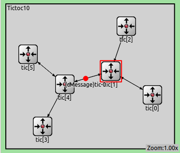
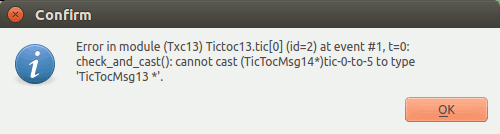
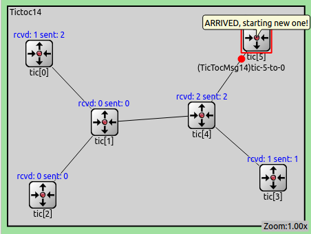
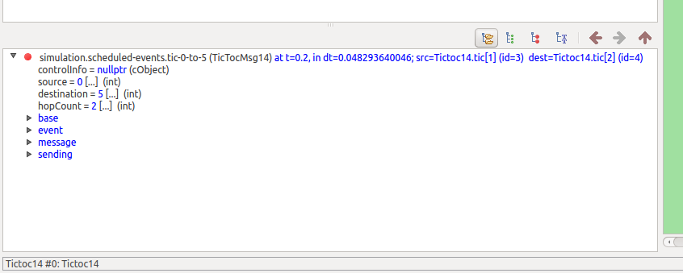

4 - Turning it into a Real Network
==================================

4.1 More than two nodes
-----------------------

Now we'll make a big step: create several ``tic`` modules and connect
them into a network. For now, we'll keep it simple what they do:
one of the nodes generates a message, and the others keep tossing
it around in random directions until it arrives at
a predetermined destination node.

The NED file will need a few changes. First of all, the :ned:`Txc` module will
need to have multiple input and output gates:

.. literalinclude:: code/tictoc10.ned
    :language: ned
    :start-at: simple Txc10 
    :end-at: }

The :ned:`[ ]` turns the gates into gate vectors. The size of the vector
(the number of gates) will be determined where we use Txc to build
the network.

.. literalinclude:: code/tictoc10.ned
    :language: ned
    :start-at: network Tictoc10 

Here we created 6 modules as a module vector, and connected them.

The resulting topology looks like this:

In this version, :ned:`tic[0]` will generate the message to be sent around.
This is done in :cpp:`initialize()`, with the help of the :cpp:`getIndex()` function which
returns the index of the module in the vector.

The meat of the code is the :cpp:`forwardMessage()` function which we invoke
from :cpp:`handleMessage()` whenever a message arrives at the node. It draws
a random gate number, and sends out message on that gate.

.. literalinclude:: code/txc10.cc
    :language: cpp
    :start-at: void Txc10::forwardMessage 
    :end-at: }

When the message arrives at :ned:`tic[3]`, its :cpp:`handleMessage()` will delete the message.

.. note::
    :title: Exercise

    You'll notice that this simple "routing" is not very efficient:
    often the packet keeps bouncing between two nodes for a while before it is sent
    to a different direction. This can be improved somewhat if nodes don't send
    the packet back to the sender. Implement this. Hints: :cpp:`cMessage::getArrivalGate()`,
    :cpp:`cGate::getIndex()`. Note that if the message didn't arrive via a gate but was
    a self-message, then :cpp:`getArrivalGate()` returns :cpp:`nullptr`.

Sources: :download:`tictoc10.ned <code/tictoc10.ned>`, :download:`txc10.cc <code/txc10.cc>`, :download:`omnetpp.ini <code/omnetpp.ini>`

4.2 Channels and inner type definitions
---------------------------------------

Our new network definition is getting quite complex and long, especially
the connections section. Let's try to simplify it. The first thing we
notice is that the connections always use the same :par:`delay` parameter.
It is possible to create types for the connections (they are called channels)
similarly to simple modules. We should create a channel type which specifies the
delay parameter and we will use that type for all connections in the network.

.. literalinclude:: code/tictoc11.ned
    :language: ned
    :start-at: network Tictoc11 
    :end-at: submodules

As you have noticed we have defined the new channel type inside the network definition
by adding a :ned:`types` section. This type definition is only visible inside the
network. It is called as a local or inner type. You can use simple modules as inner types
too, if you wish.

.. note::
    We have created the channel by specializing the built-in :ned:`DelayChannel`.
    (built-in channels can be found inside the :ned:`ned` package. Thats why we used
    the full type name :ned:`ned.DelayChannel`) after the :ned:`extends` keyword.

Now let's check how the :ned:`connections` section changed.

.. literalinclude:: code/tictoc11.ned
    :language: ned
    :start-at: connections: 

As you see we just specify the channel name inside the connection definition.
This allows to easily change the delay parameter for the whole network.

Sources: :download:`tictoc11.ned <code/tictoc11.ned>`, :download:`txc11.cc <code/txc11.cc>`, :download:`omnetpp.ini <code/omnetpp.ini>`

4.3 Using two-way connections
-----------------------------

If we check the :ned:`connections` section a little more, we will realize that
each node pair is connected with two connections. One for each direction.
|omnet++| 4 supports two way connections, so let's use them.

First of all, we have to define two-way (or so called :ned:`inout`) gates instead of the
separate :ned:`input` and :ned:`output` gates we used previously.

.. literalinclude:: code/tictoc12.ned
    :language: ned
    :start-at: simple Txc12 
    :end-at: }
    :emphasize-lines: 6

The new :ned:`connections` section would look like this:

.. literalinclude:: code/tictoc12.ned
    :language: ned
    :start-at: connections: 
    :end-at: }

We have modified the gate names so we have to make some modifications to the
C++ code.

.. literalinclude:: code/txc12.cc
    :language: cpp
    :start-at: void Txc12::forwardMessage 
    :end-at: }

.. note::
    The special :ned:`$i` and :ned:`$o` suffix after the gate name allows us to use the
    connection's two direction separately.

Sources: :download:`tictoc12.ned <code/tictoc12.ned>`, :download:`txc12.cc <code/txc12.cc>`, :download:`omnetpp.ini <code/omnetpp.ini>`

4.4 Defining our message class
------------------------------

In this step the destination address is no longer hardcoded :ned:`tic[3]` -- we draw a
random destination, and we'll add the destination address to the message.

The best way is to subclass cMessage and add destination as a data member.
Hand-coding the message class is usually tedious because it contains
a lot of boilerplate code, so we let |omnet++| generate the class for us.
The message class specification is in :file:`tictoc13.msg`:

.. literalinclude:: code/tictoc13.msg
    :language: msg
    :start-at: message TicTocMsg13 

.. note::
    See :ref:`cha:msg-def` of the :doc:`Simulation Manual </manual/index>` for more details on messages.

The makefile is set up so that the message compiler, :command:`opp_msgc` is invoked
and it generates :file:`tictoc13_m.h` and :file:`tictoc13_m.cc` from the message declaration
(The file names are generated from the :file:`tictoc13.msg` file name, not the message type name).
They will contain a generated :cpp:`TicTocMsg13` class subclassed from :cpp:`cMessage`;
the class will have getter and setter methods for every field.

We'll include :file:`tictoc13_m.h` into our C++ code, and we can use :file:`TicTocMsg13` as
any other class.

.. literalinclude:: code/txc13.cc
    :language: cpp
    :start-after: cMessage 
    :end-at: tictoc13_m.h

For example, we use the following lines in :cpp:`generateMessage()` to create the
message and fill its fields.

.. literalinclude:: code/txc13.cc
    :language: cpp
    :start-after: Create message object
    :end-at: return msg;
    :dedent:

Then, :cpp:`handleMessage()` begins like this:

.. literalinclude:: code/txc13.cc
    :language: cpp
    :start-at: void Txc13::handleMessage( 
    :end-at: getDestination

In the argument to :cpp:`handleMessage()`, we get the message as a :cpp:`cMessage*` pointer.
However, we can only access its fields defined in :cpp:`TicTocMsg13` if we cast
msg to :cpp:`TicTocMsg13*`. Plain C-style cast (:cpp:`(TicTocMsg13 *)msg`)
is not safe because if the message is *not* a `TicTocMsg13` after all
the program will just crash, causing an error which is difficult to explore.

C++ offers a solution which is called :cpp:`dynamic_cast`. Here we use :cpp:`check_and_cast<>()`
which is provided by |omnet++|: it tries to cast the pointer via :cpp:`dynamic_cast`,
and if it fails it stops the simulation with an error message, similar to the
following:

In the next line, we check if the destination address is the same as the
node's address. The :cpp:`getIndex()` member function returns the index
of the module in the submodule vector (remember, in the NED file we
declared it as :ned:`tic[6]: Txc13`, so our nodes have addresses :ned:`0..5`).

To make the model execute longer, after a message arrives to its destination
the destination node will generate another message with a random destination
address, and so forth.

When you run the model, it'll look like this:

You can click on the messages to see their content in the inspector window.
Double-clicking will open the inspector in a new window.
(You'll either have to temporarily stop the simulation for that,
or to be very fast in handling the mouse). The inspector window
displays lots of useful information; the message fields can be seen
on the :guilabel:`Contents` page.

.. note::
    :title: Exercise

    In this model, there is only one message underway at any
    given moment: nodes only generate a message when another message arrives
    at them. We did it this way to make it easier to follow the simulation.
    Change the module class so that instead, it generates messages periodically.
    The interval between messages should be a module parameter, returning
    exponentially distributed random numbers.

Sources: :download:`tictoc13.ned <code/tictoc13.ned>`, :download:`tictoc13.msg <code/tictoc13.msg>`, :download:`txc13.cc <code/txc13.cc>`, :download:`omnetpp.ini <code/omnetpp.ini>`
