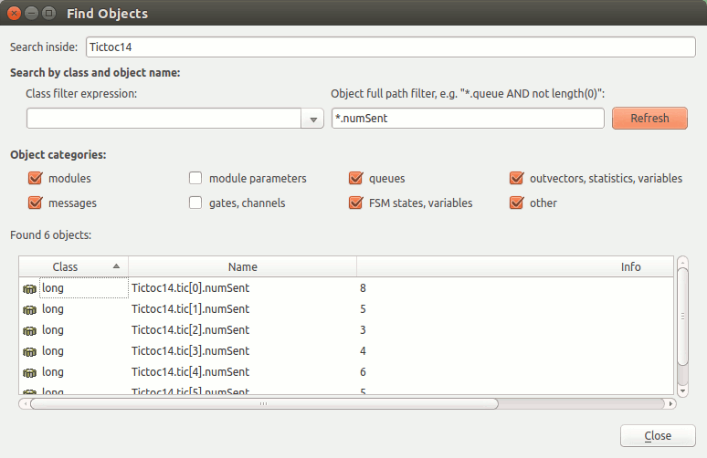
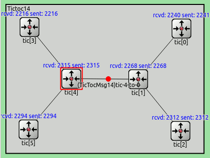
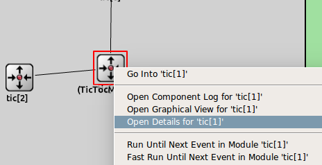
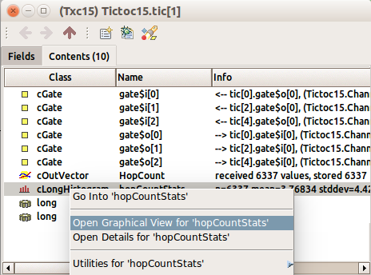
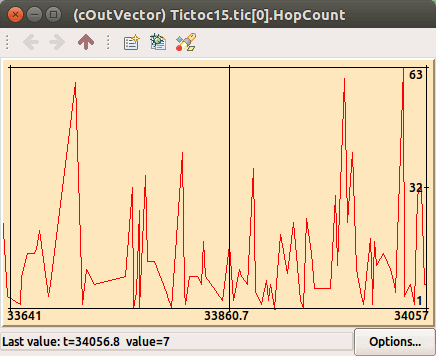
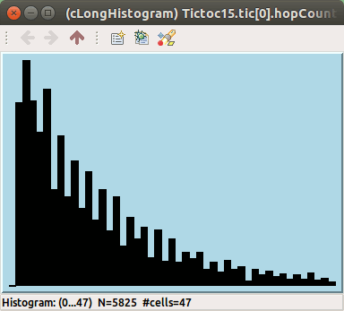
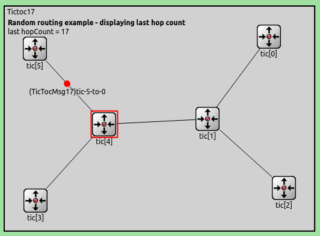

5 - Adding Statistics Collection
================================

5.1 Displaying the number of packets sent/received
--------------------------------------------------

To get an overview at runtime how many messages each node sent or
received, we've added two counters to the module class: :cpp:`numSent` and :cpp:`numReceived`.

.. literalinclude:: code/txc14.cc
    :language: cpp
    :start-at: class Txc14 
    :end-at: protected:
    :emphasize-lines: 4,5

They are set to zero and :cpp:`WATCH`'ed in the :cpp:`initialize()` method. Now we
can use the :guilabel:`Find/inspect` objects dialog (:guilabel:`Inspect` menu; it is also on
the toolbar) to learn how many packets were sent or received by the
various nodes.

It's true that in this concrete simulation model the numbers will be
roughly the same, so you can only learn from them that :cpp:`intuniform()`
works properly. But in real-life simulations it can be very useful that
you can quickly get an overview about the state of various nodes in the
model.

It can be also arranged that this info appears above the module
icons. The :ned:`t=` display string tag specifies the text;
we only need to modify the displays string during runtime.
The following code does the job:

.. literalinclude:: code/txc14.cc
    :language: cpp
    :start-at: void Txc14::refreshDisplay( 
    :end-at: }
    :emphasize-lines: 5

And the result looks like this:

Sources: :download:`tictoc14.ned <code/tictoc14.ned>`, :download:`tictoc14.msg <code/tictoc14.msg>`, :download:`txc14.cc <code/txc14.cc>`, :download:`omnetpp.ini <code/omnetpp.ini>`

5.2 Adding statistics collection
--------------------------------

The previous simulation model does something interesting enough
so that we can collect some statistics. For example, you may be interested
in the average hop count a message has to travel before reaching
its destination.

We'll record in the hop count of every message upon arrival into
an output vector (a sequence of (time,value) pairs, sort of a time series).
We also calculate mean, standard deviation, minimum, maximum values per node, and
write them into a file at the end of the simulation. Then we'll use
tools from the |omnet++| IDE to analyse the output files.

For that, we add an output vector object (which will record the data into
:file:`Tictoc15-#0.vec`) and a histogram object (which also calculates mean, etc)
to the class.

.. literalinclude:: code/txc15.cc
    :language: cpp
    :start-at: class Txc15 
    :end-at: protected:
    :emphasize-lines: 6,7

When a message arrives at the destination node, we update the statistics.
The following code has been added to :cpp:`handleMessage()`:

.. literalinclude:: code/txc15.cc
    :language: cpp
    :start-at: hopCountVector.record 
    :end-at: hopCountStats.collect
    :dedent:

The :cpp:`hopCountVector.record()` call writes the data into :file:`Tictoc15-#0.vec`.
With a large simulation model or long execution time, the :file:`Tictoc15-#0.vec` file
may grow very large. To handle this situation, you can specifically
disable/enable vector in omnetpp.ini, and you can also specify
a simulation time interval in which you're interested
(data recorded outside this interval will be discarded.)

When you begin a new simulation, the existing :file:`Tictoc15-#0.vec/sca`
files get deleted.

Scalar data (collected by the histogram object in this simulation)
have to be recorded manually, in the :cpp:`finish()` function.
:cpp:`finish()` is invoked on successful completion of the simulation,
i.e. not when it's stopped with an error. The :cpp:`recordScalar()` calls
in the code below write into the :file:`Tictoc15-#0.sca` file.

.. literalinclude:: code/txc15.cc
    :language: cpp
    :start-at: ::finish 
    :end-at: }
    :emphasize-lines: 11-12

The files are stored in the :file:`results/` subdirectory.

You can also view the data during simulation. To do that, right click on a module, and
choose :guilabel:`Open Details`. In the module inspector's :guilabel:`Contents` page you'll find the :guilabel:`hopCountStats`
and :guilabel:`hopCountVector` objects. To open their inspectors, right click on :guilabel:`cHistogram hopCountStats` or
:guilabel:`cOutVector HopCount`, and click :guilabel:`Open Graphical View`.

    
    Opening the Inspector

    
    The Inspector    

They will be initially empty -- run the simulation in :guilabel:`Fast` (or even :guilabel:`Express`)
mode to get enough data to be displayed. After a while you'll get something like this:

    Vector Inspector

    Histogram Inspector

When you think enough data has been collected, you can stop the simulation
and then we'll analyse the result files (:file:`Tictoc15-#0.vec` and
:file:`Tictoc15-#0.sca`) off-line. You'll need to choose :menuselection:`Simulate -> Call finish()`
from the menu (or click the corresponding toolbar button) before exiting --
this will cause the :cpp:`finish()` functions to run and data to be written into
:file:`Tictoc15-#0.sca`.

Sources: :download:`tictoc15.ned <code/tictoc15.ned>`, :download:`tictoc15.msg <code/tictoc15.msg>`, :download:`txc15.cc <code/txc15.cc>`, :download:`omnetpp.ini <code/omnetpp.ini>`

5.3 Statistic collection without modifying your model
-----------------------------------------------------

In the previous step we have added statistic collection to our model.
While we can compute and save any value we wish, usually it is not known
at the time of writing the model, what data the enduser will need.

|omnet++| provides an additional mechanism to record values and events.
Any model can emit *signals* that can carry a value or an object. The
model writer just have to decide what signals to emit, what data to attach
to them and when to emit them. The enduser can attach 'listeners' to these
signals that can process or record these data items. This way the model
code does not have to contain any code that is specific to the statistics
collection and the enduser can freely add additional statistics without
even looking into the C++ code.

We will re-write the statistic collection introduced in the last step to
use signals. First of all, we can safely remove all statistic related variables
from our module. There is no need for the :cpp:`cOutVector` and
:cpp:`cHistogram` classes either. We will need only a single signal
that carries the :cpp:`hopCount` of the message at the time of message
arrival at the destination.

First we need to define our signal. The :cpp:`arrivalSignal` is just an
identifier that can be used later to easily refer to our signal.

.. literalinclude:: code/txc16.cc
    :language: cpp
    :start-at: class Txc16 
    :end-at: protected:
    :emphasize-lines: 4

We must register all signals before using them. The best place to do this
is the :cpp:`initialize()` method of the module.

.. literalinclude:: code/txc16.cc
    :language: cpp
    :start-at: ::initialize() 
    :end-at: getIndex()
    :emphasize-lines: 3

Now we can emit our signal, when the message has arrived to the destination node.

.. literalinclude:: code/txc16.cc
    :language: cpp
    :start-at: ::handleMessage( 
    :end-at: EV
    :emphasize-lines: 9

As we do not have to save or store anything manually, the :cpp:`finish()` method
can be deleted. We no longer need it.

The last step is that we have to define the emitted signal also in the NED file.
Declaring signals in the NED file allows you to have all information about your
module in one place. You will see the parameters it takes, its input and output
gates, and also the signals and statistics it provides.

.. literalinclude:: code/tictoc16.ned
    :language: ned
    :start-at: simple Txc16 
    :end-before: display
    :emphasize-lines: 4

Now we can define also a statistic that should be collected by default. Our previous example
has collected statistics (max, min, mean, count, etc.) about the hop count of the
arriving messages, so let's collect the same data here, too.

The :ned:`source` key specifies the signal we want our statistic to attach to.
The :ned:`record` key can be used to tell what should be done with the received
data. In our case we specify that each value must be saved in a vector file (vector)
and also we need to calculate min,max,mean,count etc. (stats). 

.. note:: 
    
    ``stats`` is just a shorthand for ``min``, ``max``, ``mean``, ``sum``, ``count``, etc.
    With this step we have finished our model.

Now we have just realized that we would like to see a histogram of the :ned:`hopCount` on the
:ned:`tic[1]` module. On the other hand we are short on disk storage and we are not interested
having the vector data for the first three module :ned:`tic` 0,1,2. No problem. We can add our
histogram and remove the unneeded vector recording without even touching the C++ or NED
files. Just open the INI file and modify the statistic recording:

.. literalinclude:: code/omnetpp.ini
    :language: ini
    :start-at: [Tictoc16] 
    :end-at: tic[0..2]

We can configure a wide range of statistics without even looking into the C++ code,
provided that the original model emits the necessary signals for us.

Sources: :download:`tictoc16.ned <code/tictoc16.ned>`, :download:`tictoc16.msg <code/tictoc16.msg>`, :download:`txc16.cc <code/txc16.cc>`, :download:`omnetpp.ini <code/omnetpp.ini>`

5.4 Adding figures
------------------

|omnet++| can display figures on the canvas, such as text, geometric shapes or images.
These figures can be static, or change dynamically according to what happens in the simulation.
In this case, we will display a static descriptive text, and a dynamic text showing the hop count of the last message that arrived at its destination.

We create figures in :download:`tictoc17.ned <code/tictoc17.ned>`, with the :par:`@figure` property.

.. literalinclude:: code/tictoc17.ned
    :language: ned
    :start-at: network Tictoc17 
    :end-at: lasthopcount

This creates two text figures named :ned:`description` and :ned:`lasthopcount`, and sets their positions on the canvas (we place them in the top right corner).
The :par:`font` attribute sets the figure text's font. It has three parameters: :par:`typeface, size, style`. Any one of them
can be omitted to leave the parameter at default. Here we set the description figure's font to bold.

By default the text in :ned:`lasthopcount` is static, but we'll
change it when a message arrives. This is done in :download:`txc17.cc <code/txc17.cc>`, in the :cpp:`handleMessage()` function.

.. literalinclude:: code/txc17.cc
    :language: cpp
    :start-at: hasGUI 
    :end-at: setText
    :emphasize-lines: 5-9

The figure is represented by the :cpp:`cTextFigure` C++ class. There are several figure types,
all of them are subclassed from the :cpp:`cFigure` base class.
We insert the code responsible for updating the figure text after we retrieve the :cpp:`hopcount` variable.

We want to draw the figures on the network's canvas. The :cpp:`getParentModule()` function returns the parent of the node, ie. the network.
Then the :cpp:`getCanvas()` function returns the network's canvas, and :cpp:`getFigure()` gets the figure by name.
Then, we update the figure's text with the :cpp:`setText()` function.

.. tip::

    For more information on figures and the canvas, see :ref:`sec:graphics:canvas` section of the :doc:`Simulation Manual </manual/index>`

When you run the simulation, the figure displays ``last hopCount: N/A`` before the arrival of the first message.
Then, it is updated whenever a message arrives at its destination.

.. tip::

    If the figure text and nodes overlap, press :guilabel:`re-layout`.

    .. image:: images/relayout.png

In the last few steps, we have collected and displayed statistics. In the next part,
we'll see and analyze them in the IDE.

Sources: :download:`tictoc17.ned <code/tictoc17.ned>`, :download:`tictoc17.msg <code/tictoc17.msg>`, :download:`txc17.cc <code/txc17.cc>`, :download:`omnetpp.ini <code/omnetpp.ini>`
