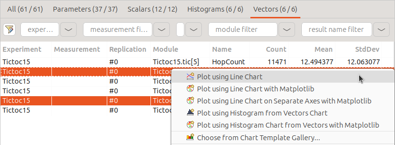
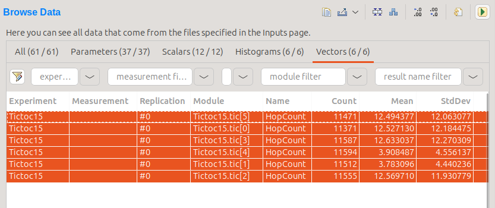
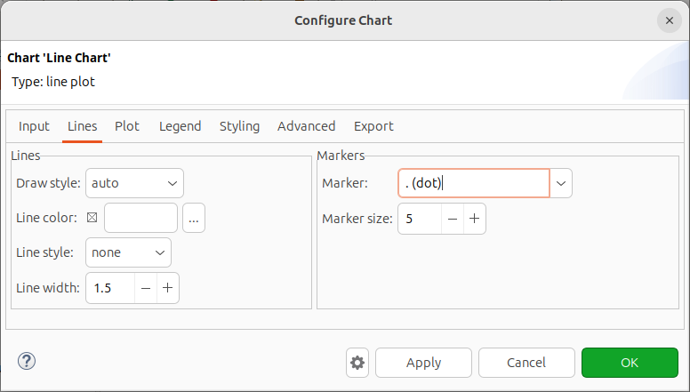
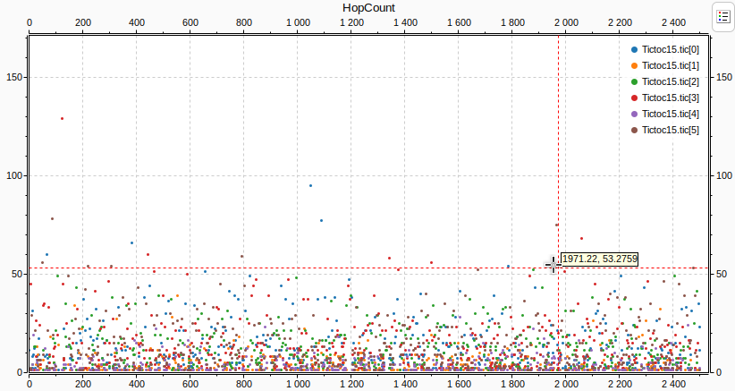
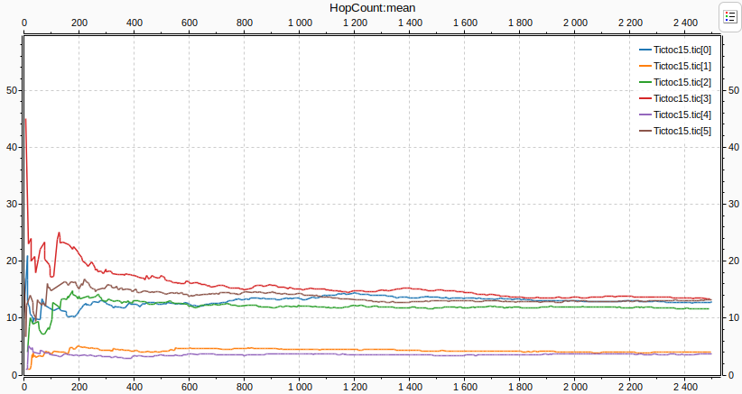
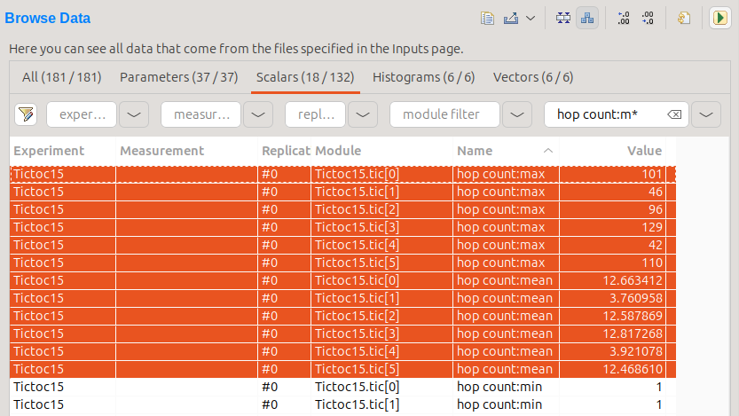
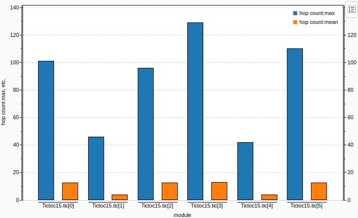
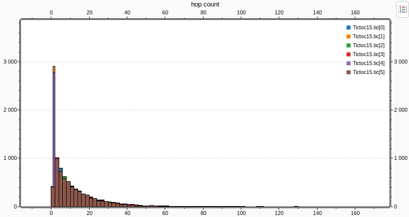

6 - Visualizing the Results With the IDE
========================================

6.1 Visualizing output scalars and vectors
------------------------------------------

The |omnet++| IDE can help you analyze your results. It supports filtering,
processing, and displaying scalar, vector, and histogram data.
The following diagrams have been created with the Result Analysis tool of the IDE.

The :file:`results` directory in the project folder contains :file:`.vec` and :file:`.sca` files, which are
the files that store the results in vector and scalar form, respectively.
Vectors record data values as a function of time, while scalars typically record
aggregate values at the end of the simulation. To open the Result Analysis tool, double
click on either the :file:`.vec` or the :file:`.sca` files in the |omnet++| IDE. Both files will be
loaded by the Result Analysis tool. 

You can find the :guilabel:`Browse Data` tab at the bottom
of the Result Analysis tool panel. Here you can browse results by type by switching the
various tabs at the top of the tool panel, ie. :guilabel:`Scalars`, 
:guilabel:`Vectors`, :guilabel:`Statistics`, or :guilabel:`Histograms`.
By default, all results of a result type are displayed. You can filter them by the module filter
to view all or some of the individual modules, or the statistic name filter to display different
types of statistics, ie. mean, max, min, standard deviation, etc. You can select some or all of
the individual results by highlighting them. If you select multiple results, they will be plotted
on one chart. Right click and select one of the :guilabel:`Plot using ...` menu items to display the figures.

.. tip::

    For further information about the charting and processing capabilities,
    please refer to the :ref:`user-guide` (you can find it in the `doc` directory
    of the |omnet++| installation).

Our last model records the :cpp:`hopCount` of a message each time the message
reaches its destination. To plot these vectors for all nodes, select the 6 lines in the browse data tab,
then right click and select :guilabel:`Plot using Line chart`.

We can change various options about how the data on the chart is displayed.
Right click on the chart background, and select :guilabel:`Configure Chart`.
In the appearing dialog, on the :guilabel:`Lines` tab, set :guilabel:`Line style` to 
``none``, and ``Marker`` to ``.`` (dot).

The chart looks like the following:

If we apply a ``mean`` operation we can see how the ``hopCount`` in the different
nodes converge to an average.
Right-click the chart, and select :menuselection:`Apply... -> Mean`.
Again, right-click on the chart background, and select :guilabel:`Configure Chart`.
In the :guilabel:`Lines` tab, set :guilabel:`Line style` to ``solid``, and ``Marker`` to ``none``.
The mean is displayed on the following chart. The lines are easier to see this way because they are thinner.

Scalar data can be plotted on bar charts.
The next chart displays the mean and the maximum of the ``hopCount`` of the messages
for each destination node, based on the scalar data recorded at the end of the simulation.
In the :guilabel:`Browse data` tab, select :guilabel:`Scalars`, and make sure that the 
:guilabel:`Show Statistics/Vector Fields as Scalars` button is enabled on the top-right
toolbar. Now select ``hop count:max`` and ``hop count:mean`` for all 6 nodes.
You can use filtering and sorting to find the scalars easier, as shown below.

This is how the chart looks like:

To create a histogram that shows ``hopCount``'s distribution, select :guilabel:`Histograms`
on the :guilabel:`Browse Data` tab. Select all rows, then right click, and
choose :guilabel:`Plot using Histogram Chart`.

