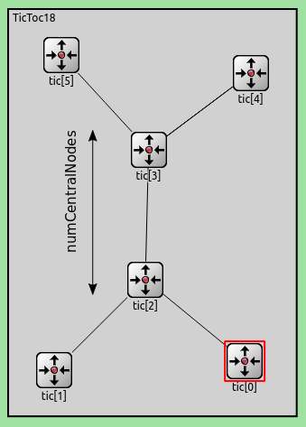
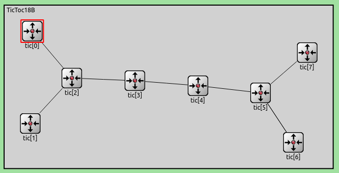
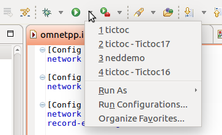
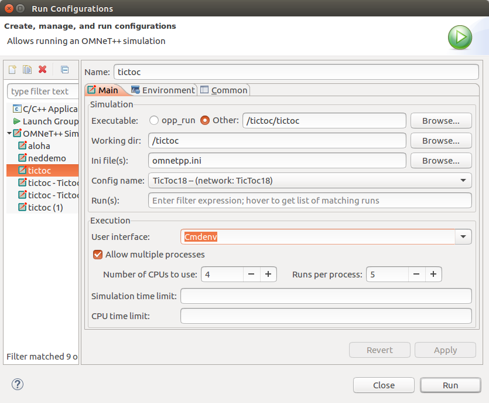
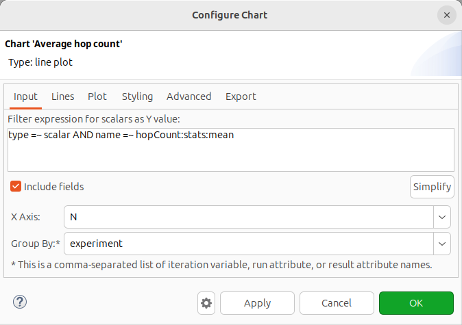
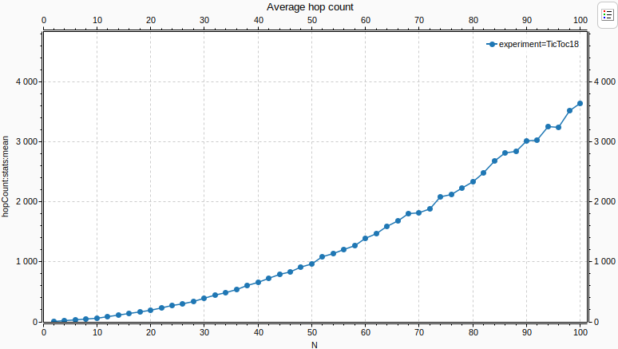
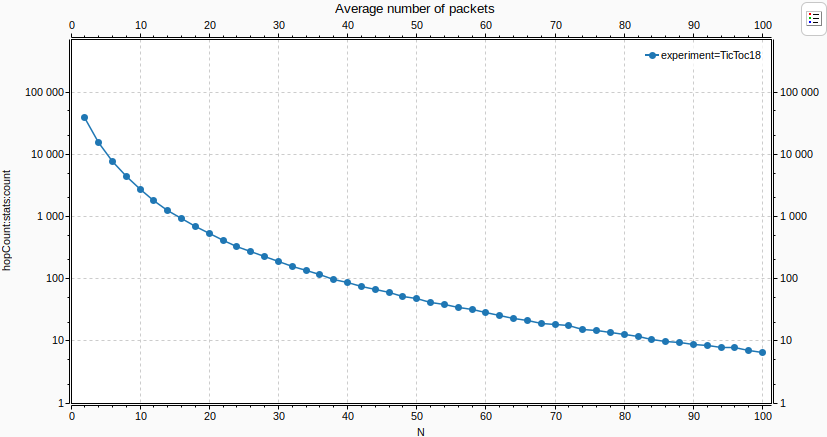

7 - Parameter Studies
=====================

7.1 The goal
------------

We want to run the simulation with a different number of nodes, and see how
the behavior of the network changes. With |omnet++| you can do parameter studies,
which are multiple simulation runs with different parameter values.

We'll make the number of central nodes (the "handle" in the dumbbell shape) a parameter, and
use the same random routing protocol as before. We're interested in how the average
hop count depends on the number of nodes.

7.2 Making the network topology parametric
------------------------------------------

To parameterize the network, the number of nodes is given as a NED parameter,
:par:`numCentralNodes`. This parameter specifies how many nodes are in the central
section of the network, but doesn't cover the two nodes at each side.

    Dumbbell network

The total number of nodes including the four nodes on the sides is ``numCentralNodes+4``.
The default of the :par:`numCentralNodes` parameter is 2, this corresponds
to the network in the previous step.

.. literalinclude:: code/tictoc18.ned
    :language: ned
    :start-at: network TicToc18 
    :end-at: Txc18;
    :emphasize-lines: 4

Now, we must specify that the variable number of nodes should be connected into the dumbbell shape.
First, the two nodes on one side is connected to the third one. Then the the last two nodes on the other side is
connected to the third last. The nodes in the center of the dumbbell can be connected with a for loop.
Starting from the third, each *i* th node is connected to the *i+1* th.

.. literalinclude:: code/tictoc18.ned
    :language: ned
    :start-at: connections: 
    :end-at: numCentralNodes+3

    The network looks like this with ``numCentralNodes = 4``

To run the simulation with multiple different values of :par:`numCentralNodes`, we specify
the variable :ini:`N` in the ini file:

.. literalinclude:: code/omnetpp.ini
    :language: ini
    :start-after: +vector 
    :end-at: numCentralNodes = $

7.3 Setting up a parameter study
--------------------------------

We specify that *N* should go from 2 to 100, in steps of 2.
This produces about 50 simulation runs. Each can be explored in the graphical user interface, but
simulation batches are often run from the command line interface using the *Cmdenv* runtime environment.

.. tip::

    You can find more information on variables and parameter studies in the
    :ref:`sec:config-sim:parameter-studies` section of the :doc:`Simulation Manual </manual/index>`.

To increase the accuracy of the simulation we may need to run the same simulation several times
using different random numbers. These runs are called *Repetitions* and are specified in :file:`omnetpp.ini`:

.. literalinclude:: code/omnetpp.ini
    :language: ini
    :start-at: repeat = 4
    :end-at: repeat = 4

This means that each simulation run will be executed four times, each time with a different seed for the RNGs.
This produces more samples, which can be averaged. With more repetitions, the results will increasingly converge
to the expected values.

7.4 Running the parameter study
-------------------------------

Now, we can run the simulations. In the dropdown menu of the *Run* icon, select *Run Configurations*.

    Run configurations menu

In the :guilabel:`Run Configurations` dialog, select the config name, make sure
:guilabel:`Cmdenv` is selected as the user interface.

    Run configurations dialog

.. tip::
    
    If you have a multi-core CPU, you can specify how many simulations to run concurrently.

Alternatively, you can run the simulation batches from the command line with
:command:`opp_runall` tool with the following command:

.. code-block:: shell

    opp_runall -j4 ./tictoc -u Cmdenv -c TicToc18

The ``-j`` parameter specifies the number of CPU cores, the ``-u`` parameter the user interface, and ``-c`` the config to run.

7.5 Analyzing the results
-------------------------

Now, we can visualize and analyze the data we've collected from the simulation runs.
We'll display the average hop count for messages that reach their destinations vs :ini:`N`, the number of central nodes.
Additionally, we will display the average number of packets that reached their destinations vs :ini:`N`.
The analysis file :file:`Tictoc18.anf` contains the dataset we will use for the visualization.

These two average scalars are not recorded during the simulation, we will have to compute them from the available data.

The hop count is recorded at each node when a message arrives, so the mean of hop count will be available as a statistic.
But this is recorded per node, and we're interested in the average of the mean hop count for all nodes.
The Scatter Chart can average multiple values before plotting them.

.. tip::

    Refer to the chapter "Analysing the Results" in the :ref:`user-guide` for more information on charts. 
    You can find it in the :file:`doc` directory of your |omnet++| installation.

To make the chart average the hop count over all nodes instead of plotting them as separate lines,
set the axes in the configuration dialog as shown:

    Chart configuration dialog

    Average hop count vs N

The average hop count increases as the network gets larger, as packets travel more to reach their destination.
The increase is polynomial.

We're also interested in the average number of packets that arrive at their destination.
The count of the arrived packets is available at each node.

    The average number of packets that arrived vs N

Notice that the Y axis is logarithmic. The average number of packets that arrive decreases rapidly
as :ini:`N` increases, and the network gets larger.

